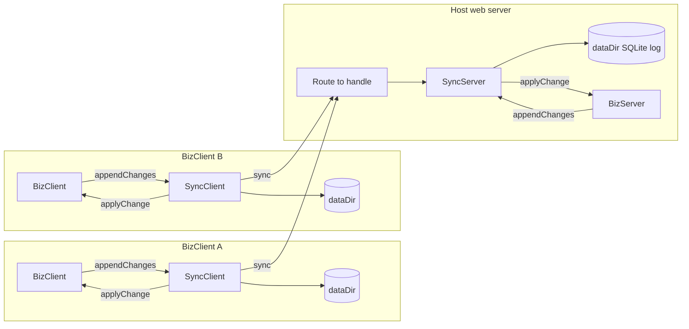

# syncbridge

Requirements: [docs/A0-syncbridge-requirements.md](./docs/A0-syncbridge-requirements.md)  
Design: [docs/A1-syncbridge-highlevel-design.md](./docs/A1-syncbridge-highlevel-design.md)  
Changing subject: [docs/A1-1-syncbridge-changing-subject.md](./docs/A1-1-syncbridge-changing-subject.md)  
Client send: [docs/B1-syncbridge-client-send.md](./docs/B1-syncbridge-client-send.md)

## Difficulties of a sync system

The hard part is watching the sync with a state machine. The first diagram looks small: idle, dirty, uploading, synced, failed. Each real accident adds a state and a set of arrows, and the machine becomes the thing that has to be debugged.

A timeout is not a failure. The server may have stored the edit and the phone may have missed the response. That single unknown splits `uploading` into `maybe-sent`, `sent-unacked`, and `retry`. Retry from `maybe-sent` writes the edit a second time. Staying in `sent-unacked` forever leaves the phone silent while the server already has the change.

A photo is a second object with its own life. The note can be `uploading` while the file is `pending`, `uploading`, `uploaded`, or `missing`. Those combine. `note-synced / photo-failed` and `note-failed / photo-synced` are different bugs, and both leave a record on one side that points at bytes the other side does not have.

The process dies between two arrows. The row is written and the machine is still `applying`. After restart the machine says `applying`, the row is already there, and the next pass applies it again. Or the machine is moved to `synced` and the write never landed, so the next pass skips it. The label in the machine and the bytes on disk now disagree, and every later state is built on that label.

A batch makes it worse. Ten changes in one request can be accepted through item 4. The machine has one state for the batch. Item 5 failed. There is no honest box for "4 done, 5 unknown, 6 never sent" that also survives a restart.

A second phone, a reinstall, or a clock that calls one edit newer adds more boxes: `conflict`, `their-copy-wins`, `need-full-resync`. Each box is a guess about another device. The guess is stale as soon as that device syncs again. The diagram is now the product of network result, local write, remote write, each attachment, and each item in the batch. People stop drawing it. The remaining code still switches on those states, and a path that was never drawn is the one a user hits in the field.

## Goal of this SyncBridge lightweight library

SyncBridge moves opaque change packages between clients and one server. It owns the ordered subject log, each client's pointer and retry queue, and the attachment transfer.

The business app owns the subject string, the package, and `applyChange`. That callback writes the business data and the final copy of any attachment. The host web server listens, checks the caller, and routes a request to `syncServer.handle(req, res)`.

SyncBridge reads the HTTP method and its parameters. It does not choose the endpoint path, listen on a port, poll, or open `package.data`.

## System

BizClient and BizServer are the application. SyncClient and SyncServer are the library. Two clients that pass the same subject share one server log. Each client keeps its own pointer.



## Usage tutorial

The phone follows this sequence. The host web server is the other end of the same calls. Install the same package in both projects. The phone imports `syncbridge/expo`. The host imports `syncbridge/node`.

```sh
npm install github:juntjtang18/syncbridge
```

```json
"dependencies": {
  "syncbridge": "github:juntjtang18/syncbridge"
}
```

1. On the host, create the server and bind `handle` to the path the phone will call. This example uses `/sync`. `currentSubject(req)` returns the live subject for the signed-in user.

```js
import http from "node:http"
import { createSyncServer } from "syncbridge/node"

const syncServer = createSyncServer({ dataDir: serverDir, currentSubject })
syncServer.init(subject, async (entry, attachments) => {
  const photo = attachments.get("photo-1")
  const bytes = photo ? await photo.read() : null
  // Store entry.package.data and bytes in server business storage.
  // Return the stored path when it differs from the sender's path.
  return { attachments: [{ id: "photo-1", path: storedPath }] }
}, { readAttachment })

http.createServer((req, res) => {
  const url = new URL(req.url, "http://localhost")
  if (url.pathname === "/sync") {
    syncServer.handle(req, res)
    return
  }
}).listen(port)
```

The ack is sent after the log row and the attachment temp are saved. A worker then calls `applyChange`. Throw from that callback when the business write fails. The worker tries three times, then records `apply failed after 3 attempts: …` and continues. `await syncServer.whenIdle()` waits until that queue is empty. `syncServer.failedEntries(subject)` lists send and apply failures for that subject.

2. On the phone, create one client for the signed-in user. `dataDir` is a directory that survives app restarts, such as a folder under the app document directory. `url` is the full endpoint, including `/sync`. `headers` sends the host session on every request.

```js
import { createSyncClient } from "syncbridge/expo"

const client = createSyncClient({
  dataDir,
  url: new URL("/sync", baseUrl).toString(),
  headers() {
    return { cookie: `session=${cookie}` }
  },
})
```

3. Call `init` once the user is known. `init` and `use` are the same call. It sets the current subject. `sync()` and `appendChanges` use that subject only. A subject this phone has never seen starts at pointer `0`. A known subject reuses its pointer.

`applyChange` writes a downloaded entry into local business storage. `attachments.get(id).read()` returns the temp saved during `sync()`. Throw if that local write fails. The pointer stays where the save put it. After three throws the entry is on `failedEntries()` with `apply failed after 3 attempts: …`, and later entries still apply. A change this phone uploaded is not downloaded again: the pointer moves past it, and `applyChange` is not called for it.

`readAttachment` reads a local file when this phone sends it. `manifest.path` is the path passed to `appendChanges`.

```js
await client.init(subject, async (entry, attachments) => {
  const photo = attachments.get("photo-1")
  const bytes = photo ? await photo.read() : null
  // Store entry.package.data and bytes in local business storage.
}, {
  async readAttachment(manifest) {
    // Read the file at manifest.path and return its bytes.
  },
})
```

4. Use the same subject string the host uses for that user. SyncBridge stores and compares the string. It does not parse it. One subject is one server log.

```js
"user.4"
"user.4.google.1AbCfolderId"
```

5. After the phone writes a local business change, call `appendChanges`. This queues the change. A network connection is not required. SyncBridge does not copy the file. It reads `path` later through `readAttachment`.

```js
await client.appendChanges({
  data: {
    object: "project",
    action: "add",
    id: "north-warehouse",
    name: "North warehouse",
  },
  attachments: [
    { id: "photo-1", path: photoPath, contentType: "image/jpeg" },
  ],
})
```

`data` is a string or any JSON value. Each attachment is `{ id, path, contentType }`.

6. Call `sync()` when the network is available, when the app becomes active, or when the user refreshes. SyncBridge does not poll. `sync()` uploads the outbox, waits for the ack, and saves each downloaded entry and its attachment bytes. It returns before `applyChange` runs on either side.

```js
const result = await client.sync()
if (result.status === "failed" || result.status === "partial" || result.status === "error") {
  throw new Error(result.error || "Synchronization failed.")
}
```

Treat the return like this:

- `succeed` means the outbox entries that were accepted are on the server log, and downloaded entries are saved on this phone. Rows this phone just uploaded are not downloaded again. Show synced. A send that failed three times is on this phone's failure list, and a later outbox entry sent in the same `sync()` still counts as `succeed`.
- `failed`, `partial`, and `error` mean the attempt is still under the cap of 3. Show the error state. The next `sync()` sends that entry again.
- `switched` means the live subject changed. `result.subject` is the new current subject. Call `init` again with that subject's `applyChange` before the next sync.

A local `applyChange` failure does not change this return. The screen that reads data written by `applyChange` waits for that work:

```js
await client.whenIdle()
```

`client.failedEntries()` is the list for the current subject. Send rows say `send failed after 3 attempts: …`. Apply rows say `apply failed after 3 attempts: …`.

`appendChanges` writes the change into `incoming/` and returns as soon as that file is on disk. It does not wait for a `sync()` that is already running. `sync()` sends `inflight/` and renames `incoming/` into `inflight/` only when `inflight/` is empty. A photo taken during `sync()` is still on disk if the app exits, and the next launch sends it. The rules are in [B1](./docs/B1-syncbridge-client-send.md).

A change this phone uploads comes back to it in log order, without its attachments, so every copy replays the same log and the last change logged wins everywhere. The first `sync()` writes a random `clientId` to `dataDir/client-id` when the file is missing or empty. Later syncs send that same id with `subject`, `pointer`, and `changes`. The host does not choose it. One file covers every subject on this `dataDir`. The server stores the id on each log row this install appends. Those rows come back as entries with `own: true` and an empty `attachments` list: the bytes are already on this phone, so nothing is downloaded, and `applyChange` gets the entry with `own: true`. Another phone has its own `client-id` file, so it receives the rows with their attachments. A change the server writes with `appendChanges` has no `clientId`, so every phone downloads it.

The host reads and replaces a queue directly. On the phone, `outbox()` reads `inflight/` then `incoming/` and does not wait for `sync()`. `setOutbox(records)` waits until the current `sync()` finishes, then replaces both directories. `unprocessed()` and `setUnprocessed(records)` are the local apply queue. `setUnprocessed` wakes the worker. On the server, `unprocessed(subject)` and `setUnprocessed(subject, records)` are that subject's apply queue. A record is `{ id, package, attempts }` for the upload buffer, and `{ id, position, package, attempts }` for the unprocessed queue. `package` is `{ data, attachments }`.

7. Pass a `log` when the host wants a trace of each step. The host implements `{ write(event) }`. Syncbridge calls `write` and does not print the line itself. Omit `log` and the writes go nowhere. If `log` is passed, `write` must be a function. A throw inside `write` is ignored, so a broken logger cannot change the sync result. Apply lines that happen after `sync()` returns still call `write`.

```js
const lines = []
const log = {
  write(event) {
    lines.push(event)
  },
}

const syncServer = createSyncServer({
  dataDir: serverDir,
  currentSubject,
  log,
})

const client = createSyncClient({
  dataDir,
  url: new URL("/sync", baseUrl).toString(),
  headers() {
    return { cookie: `session=${cookie}` }
  },
  log,
})
```

Each event is `{ at, side, subject, step, id, attempt, status, error, detail }`. Fields that have no value are left out. `at` is an ISO time. `side` is `"client"` or `"server"`. `detail` has ids, counts, hashes, and sizes. It does not include attachment bytes, the session cookie, or `package.data`.

| Step | When it is written |
| --- | --- |
| `append` | A change is queued. On the phone that is the outbox. On the server that is `appendChanges` into the log. |
| `put` | An attachment is uploaded. `status` is `succeed`, `failed`, or `error`. |
| `get` | The server reads attachment bytes for a download. |
| `post` | A sync request is sent or received. `detail` has the pointer and the change ids. |
| `ack` | The response status is known: `succeed`, `partial`, `failed`, `error`, or `switched`. |
| `enqueue` | A saved entry is placed on the apply queue. |
| `save` | The phone has stored a downloaded entry. |
| `pointer` | The phone moved its pointer. |
| `send` | A send failed and the attempt is still under 3. |
| `send-failed` | The third send failure was recorded. |
| `receive-failed` | The phone could not save a downloaded entry. |
| `skip` | The sender gave up on an entry and the pointer moved past it. |
| `apply` | `applyChange` is about to run. `attempt` is 1, 2, or 3. |
| `applied` | `applyChange` returned. |
| `apply-failed` | `applyChange` threw. After the third time the failure list has the row. |
| `error` | A request threw outside the predicted failure path. |

## Usage example codes

`applyChange`. You implement this function. SyncBridge calls it and does not write business data. The server passes its function to `syncServer.init`. The client passes its function to `client.use`. Each side writes into its own business storage. `entry` is `{ id, position, package }`. `attachments.get(id).read()` returns that entry's bytes. Throw if a write fails.

```js
import { mkdir, writeFile } from "node:fs/promises"
import path from "node:path"

async function applyChange(entry, attachments) {
  const folder = path.join(businessDir, String(entry.position))
  await mkdir(folder, { recursive: true })
  await writeFile(
    path.join(folder, "data.json"),
    JSON.stringify(entry.package.data),
  )
  for (const manifest of entry.package.attachments) {
    const file = attachments.get(manifest.id)
    const bytes = await file.read()
    await writeFile(path.join(folder, file.path || manifest.id), bytes)
  }
}

syncServer.init(subject, applyChange, { readAttachment })
await client.init(subject, applyChange, { readAttachment })
```

Host server. The process listens. SyncBridge handles the routed request. `applyChange` is the function above.

```js
import http from "node:http"
import { createSyncServer } from "syncbridge/node"

const syncServer = createSyncServer({ dataDir: serverDir, currentSubject })
syncServer.init(subject, applyChange, { readAttachment })

http.createServer((req, res) => {
  const url = new URL(req.url, "http://localhost")
  if (url.pathname === "/sync") {
    syncServer.handle(req, res)
    return
  }
}).listen(port)
```

Phone. Import `syncbridge/expo`. A Node client uses `syncbridge/node` and the same calls.

```js
import { createSyncClient } from "syncbridge/expo"

const client = createSyncClient({
  dataDir,
  url: new URL("/sync", baseUrl).toString(),
  headers() {
    return { cookie: `session=${cookie}` }
  },
})

await client.init(subject, applyChange, { readAttachment })
await client.appendChanges({
  data: {
    poi,
    poiEntries: [
      { description: "Close-up", photo: { attachmentId: "photo-1" } },
    ],
  },
  attachments: [
    { id: "photo-1", path: photoPath, contentType: "image/jpeg" },
  ],
})

const result = await client.sync()
if (result.status === "failed" || result.status === "partial" || result.status === "error") {
  throw new Error(result.error || "Synchronization failed.")
}
await client.whenIdle()
```

BizServer appends a change it has already stored. This writes the log and does not call `applyChange`.

```js
await syncServer.appendChanges(subject, {
  data: { poi: "north-wall", notes: "Measure on the next visit" },
  attachments: [],
})
```
