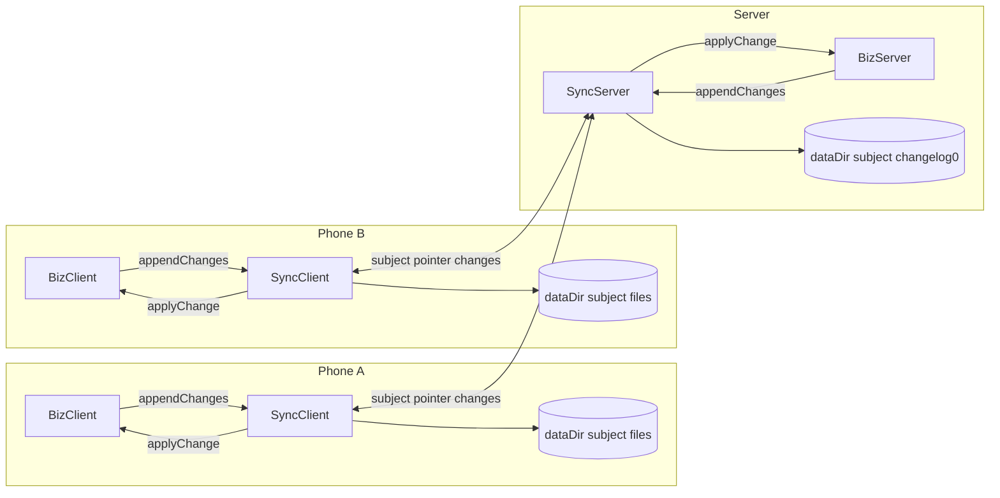

# SyncBridge — High-level design

**Status:** 2026-10-06  
**Requirements:** [A0](./A0-syncbridge-requirements.md)  
**Changing subject:** [A1-1](./A1-1-syncbridge-changing-subject.md)  
**Attachment pointer:** [A1-2](./A1-2-attachment-internal-uri.md)  
**Client send:** [B1](./B1-syncbridge-client-send.md)

SyncBridge is middleware for client-server synchronization. It moves opaque change packages. The application decides what a package means and supplies `applyChange` to write that package into its business storage.

The server owns the ordered history. A client owns only its last server position and a retry queue for its own unsent changes. SyncBridge owns both of those client files under an app-supplied `dataDir`.



Diagram 1: SyncBridge client-server synchronization

## 1. Subject

A `subject` is the name of one independent ordered log. It is one opaque string. SyncBridge does not parse or interpret it.

Nodes that use the same subject see the same log, like a publisher and subscriber that use the same queue subject. Different subjects have separate histories and separate positions.

The application can compose a readable subject from dot-separated components, escaping each component before joining:

```js
"default"
"tenant." + encode(companyId)
"tenant." + encode(tenantId) + ".seat." + encode(email)
"user." + encode(userId) + "." + encode(driver) + "." + encode(root)
```

For example, `user.4.google.1AbCfolderId` is one subject: that user, that driver, that configured root folder. `tenant.company-123.seat.mail%40example%2Ecom` is another. The application escapes components so values such as email addresses or folder ids cannot change the subject shape. SyncBridge stores and compares the final string only.

Each subject has its own server `changelog0`. Positions start at `1` only inside that subject. A pointer is a location in **that** subject's log. Position `3` on folder A is not position `3` on folder B.

A phone can use several subjects. One is **current** (the live root). The others stay on disk so a later return to that root reuses the same log and the same pointer. They remain separate logs.

## 2. Change log

Each record in `changelog0` is:

```js
{ id, position, package }
```

`id` identifies a change so a retry is not appended twice. `position` is assigned by SyncServer, starts at `1`, and orders entries only inside that subject.

`package` has one generic JSON envelope:

```js
{
  data: JSONValue,
  attachments: [
    { id, sha256, size, contentType, path }
  ],
}
```

`data` can be a string, number, boolean, `null`, JSON array, or JSON object. A plain string package is therefore just:

```js
{ data: "plain text", attachments: [] }
```

`attachments` is a sibling of `data`, not part of an application's business schema. It is the generic file mechanism. Each entry is a manifest, not the file bytes. `id` is an application-selected reference. `path` is a host-internal pointer; SyncBridge does not parse it. `sha256` and `size` are filled when the PUT stream is hashed. `contentType` is optional. Business data can refer to `attachments[].id`, but SyncBridge does not inspect that relationship.

SyncBridge serializes the package as JSON, but never evaluates or runs its `data`. A SQL or script string is only data to SyncBridge; it becomes dangerous only if an application's `applyChange` chooses to execute it.

The package passed to `appendChanges` supplies `{ id, path, contentType }` per attachment. No `bytes`. The host's `readAttachment` streams the file at `sync()`. The server hashes the PUT stream and returns `{ sha256, size }`.

SyncServer owns the log mechanics: assigning positions, keeping order, and returning records after a position. It does not store a pointer for any client.

## 3. Attachments

See [A1-2](./A1-2-attachment-internal-uri.md). SyncBridge does not keep a durable blob store. `path` is the host pointer. The sender streams through `readAttachment`. The server apply of that upload reads the in-flight PUT temp. A later receiver downloads with `GET /sync?sha256=`, and the server streams the stored file through its `readAttachment`.

During `sync()`:

```text
sender         readAttachment streams the host file
receiver       hash the PUT stream, return sha256 and size
receiver       save the log entry and the attachment temp, then ack
sender         drop the outbox id on succeed
worker         applyChange from the unprocessed queue
worker         on success, update path and delete the temp
```

The two directions use the same roles. The client is the sender and the server is the receiver for an upload. The server is the sender and the client is the receiver for a download. A `failed`, `partial`, or `error` ack adds one to that entry's send count. Attempts 1 and 2 keep it and send nothing after it. Attempt 3 moves it to the sender's failure list with `send failed after 3 attempts: …`, then the same `sync()` sends the next entry. The receiver does not count and does not write a failure-list row for a change it refused.

`applyChange` may return `{ attachments: [{ id, path }] }` so the log's `path` matches where the host stored the file. The worker calls it after the ack. The first two throws retry the head. The third writes `apply failed after 3 attempts: …` and continues. The pointer already moved when the entry was saved.

The callback contract is:

```js
async function applyChange(entry, attachments) {
  // entry = { id, position, package: { data, attachments: manifests } }

  const photo = attachments.get("photo-1")
  const bytes = await photo.read()

  // Write entry.package.data and bytes into application storage.
  // Throw if either write fails.
}
```

`attachments` is scoped to this entry. `get(id)` returns the verified attachment named by `entry.package.attachments[].id`:

```js
{
  id,
  sha256,
  size,
  contentType,
  path,
  async read(), // Promise<Uint8Array>
}
```

The contract deliberately does not expose a staging path. Node and Expo can keep different temporary-file implementations while every application reads the same attachment bytes. A later streaming reader can be added without changing attachment IDs or package schema.

For Site Inspect, `data` can be the PoI and PoI-entry descriptions; every photo becomes an attachment:

```js
{
  data: {
    poi,
    description: poiDescription,
    poiEntries: [
      { description: "Close-up", photo: { attachmentId: "photo-1" } },
    ],
  },
  attachments: [
    { id: "photo-1", path: "poi-1.jpg", contentType: "image/jpeg" },
  ],
}
```

## 4. Client

The platform entry creates a client once. That client holds **many subjects** and one **current** subject:

```js
const client = createSyncClient({ dataDir, send })
await client.use(subject, applyChange, { readAttachment })
```

`dataDir` is a persistent app directory. The Node entry uses Node file APIs; the Expo entry uses Expo file APIs. SyncBridge persists the current subject and, for every subject this device has seen, that subject's pointer and outbox. It does not copy attachment bytes:

```text
<dataDir>/client-id
<dataDir>/current
<dataDir>/subjects/<encoded-subject>/pointer
<dataDir>/subjects/<encoded-subject>/incoming/
<dataDir>/subjects/<encoded-subject>/inflight/
<dataDir>/subjects/<encoded-subject>/unprocessed.json
<dataDir>/subjects/<encoded-subject>/failures.json
```

That directory set is the persisted list `{ subject, pointer }`. There is no second index. A subject this client has never seen gets `pointer` `0`: every server log entry is new. A subject this client has seen keeps its file. Changing current does not rewrite another subject's pointer.

The public client API is:

```text
use(subject, applyChange, { readAttachment })   // create if new, reuse pointer if known, set current
current() → subject | null
subjects() → [subject]
appendChanges(changeLog)    // queues on current (offline ok)
async sync() → { status, subject? } | { status: "switched", switched: true, subject }
failedEntries() → [{ id, error, failedAt }]
whenIdle()       // current subject's unprocessed queue is empty
```

`sync()` returns `{ status: "succeed", subject }`, `{ status: "partial", subject, error }`, `{ status: "failed", error }` with `subject` when the request named one, `{ status: "error", error }` with `subject` when the request named one, or `{ status: "switched", switched: true, subject }`. A capped send that then delivers a later outbox entry still returns `succeed`. A local apply failure does not fail `sync()`.

`applyChange` is per subject. Two roots are two local trees. Do not reuse one callback that always writes the same directory.

`appendChanges(changeLog)` adds a local change to the **current** subject's `incoming/` queue and returns when that file is on disk. It does not wait for `sync()`. The send rules are in [B1](./B1-syncbridge-client-send.md). Unsent work stays on that subject if current moves away. It flushes only when that subject is current again and `sync()` runs.

`sync()` happens only when the app calls it; SyncBridge does not poll:

```text
sync:
  send one outbox entry and its attachments
  a failed, partial, or error ack counts one send attempt
  attempts 1 and 2 stop the send loop
  attempt 3 records send failed after 3 attempts and continues

  receive the live subject on the response (see §4.1)
  if the live subject differs from current:
    persist current + first-seen pointer 0
    return { status: "switched", switched: true, subject: live }

  for each entry after the saved pointer:
    save the log entry and the attachment temps
    on success, enqueue unprocessed, save the pointer, wake the worker
    on failure, post receiveFailed and stop; the server resends or skips
  return after that save; the worker applies later
```

The pointer is saved when the entry is stored, before `applyChange`. A later apply failure does not move it back. `whenIdle()` waits until the unprocessed queue is empty.

### 4.1 Changing the live subject (server folder)

The host application owns the live root (the configured driver folder). SyncBridge does not compose `user.{id}.{driver}.{root}` and does not read the driver spec.

On every `POST /sync` — the call that already names a subject — the **host** puts the live subject on the response:

```js
{ status, acceptedIds, entries, attachmentHashes, skipped, subject }
```

`subject` is always the live root, not “the one the client sent.” The extra string is cheap next to attachments. `PUT` and `GET` of raw attachment bytes do not carry a subject.

The client compares. If `response.subject` differs from the subject it sent, that is the folder change. It calls `use(response.subject, applyChange)` and makes that string current. First time this device sees it: pointer `0`. Seen before: reuse that pointer.

If the request subject is not the live subject, the host must **not** append to the old `changelog0`. It rejects (409, or an empty accept list) and still returns the live `subject`. A late sync after a folder change must not mix history into the previous log.

```text
client POST { subject: A, pointer, changes }
host live subject is B
  do not write A's changelog0
  respond { subject: B, acceptedIds: [], entries: [], … }
client use(B) → current is B
next sync() is B (pointer 0 if B is new, else B's saved pointer)
```

Leave A, go to B, return to A: A’s changelog0 and A’s pointer are reused. Resetting A to `0` on every current change would replay A’s whole history onto a tree that already applied it.

The host supplies the live subject (a `currentSubject(user)` callback, or a wrapper around `handle`). SyncBridge still only opens the log named in the request, and only if the host says that name is current.

## 5. Server

The server entry creates SyncServer once:

```js
const syncServer = createSyncServer({ dataDir, currentSubject })
syncServer.init(subject, applyChange, { readAttachment })
```

SyncServer owns `<dataDir>/syncbridge.sqlite`. It stores `log_entries` indexed by `(subject, position)` and `(subject, id)`, so it can return entries after a pointer without scanning a text file. BizServer does not open the database or implement log storage methods.

When a client sends `{ subject, pointer, changes, clientId }`, and the host says that subject is current, SyncServer:

1. Opens that subject's log (`changelog0` for that subject only).
2. Appends each new client change once, enqueues it, and assigns its position. A duplicate id is accepted and not appended again.
3. Acks `succeed`, `partial`, or `failed` without calling `applyChange`. A refused change is not stored and is not written to the failure list.
4. Returns records after `pointer` for that `clientId`, plus `skipped` ids this client has already given up, plus the live `subject`.
5. Wakes the worker. The worker drains the unprocessed queue outside the request lock.

`receiveFailed` for a `clientId` increments that send attempt. Below 3, the next response repeats that entry and does not include later ones. At 3, the server writes `send failed after 3 attempts: …` for that client and continues with the next log entry. Other clients still receive the row.

When BizServer calls `appendChanges(subject, changeLog)`, SyncServer writes that change to that subject's `changelog0` and does not enqueue it. The call returns while a client apply may still be running.

Predicted POST statuses are `succeed`, `partial`, `failed`, and `switched` (HTTP 409). Any other throw is `{ status: "error", error }` with HTTP 200. The process, the worker, and later syncs stay up.

The transport host is responsible for authenticating callers, authorizing which subjects they may use, and naming the live subject on every `POST /sync`. SyncBridge treats a subject as a log name only.

## 6. Library boundary

```text
BizClient    applyChange(entry, attachments), appendChanges; asks host for live subject
SyncClient   use, current, subjects, sync, appendChanges, failedEntries, whenIdle
SyncServer   init, handle, appendChanges, failedEntries, whenIdle
BizServer    applyChange(entry, attachments), appendChanges
Host         live subject on POST /sync; reject a request subject that is not live; readAttachment streams path after the PUT temp is gone
```

SyncBridge is not built on a normal queue. The client has an outgoing retry queue, but each server subject is a durable replayable log: multiple clients can independently read entries after their own pointers.
